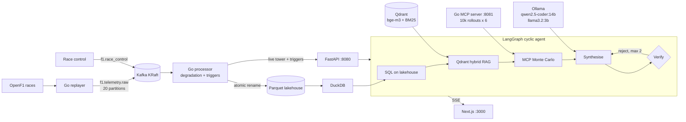

# PitWall AI

PitWall AI is a Formula 1 pit-wall strategy engine. It runs on real OpenF1 telemetry
from three Grands Prix (2023 Singapore, 2024 British, 2024 Sao Paulo), streamed through
Kafka into Go engines. These engines track fuel-corrected tyre degradation per car,
raise undercut, tyre-cliff, safety-car and wet-crossover triggers, and commit a
Parquet lakehouse that DuckDB queries while it is being written. When a trigger or a
race-control message arrives, a cyclic LangGraph agent does four things:
- reads the car's history from the lakehouse with SQL;
- retrieves the FIA Sporting Regulations in force on that race day from a Qdrant
  hybrid index;
- asks a Go Monte Carlo simulator over MCP to race 10,000 futures for each of six
  strategies;
- has the resulting call checked by a deterministic rule checker and a verifier
  model, and revises it if either rejects it.

The FastAPI control plane streams every step over SSE to a Next.js dashboard.

Everything runs on local models through Ollama, with zero paid API keys:
- **qwen2.5-coder:14b** writes the lakehouse SQL and synthesises the strategy.
- **llama3.2:3b** runs the fast verification pass and takes over when the primary
  model fails.
- **bge-m3** embeds the regulations for the Qdrant hybrid index.

Decisions are point-in-time: the agent sees only the laps, telemetry, race-control
notices and regulation edition that existed at the decision instant. The 2023 race is
judged under the 2023 rules, not later ones.

## Results on real models and telemetry streams

Measured on an Apple M5 Pro (15 cores, 24 GB). Source: `benchmarks/results.json`;
method and caveats in [docs/BENCHMARKS.md](docs/BENCHMARKS.md).

| Measurement | Result |
|---|---|
| Kafka -> Go engines, 200,000 real events, 20 partitions | **1,003,571 events/s** sustained (median of 5 trials); 826,214 events/s committed to Parquet |
| Stream-to-trigger latency at 20,000 events/s | p50 2.0 ms, p99 4.0 ms |
| DuckDB on the Parquet lakehouse while Go writes it | 32,684 concurrent queries, **0 errors**, p50 1.06 ms |
| Go Monte Carlo, 10,000 rollouts x 6 strategies over MCP | **p50 7.6 ms** round trip (6.5 ms in process) |
| DuckDB OLAP, 332,787-event lakehouse | p50 1.19 ms; decision-scoped agent SQL p50 0.91 ms |
| Qdrant Recall@3, hybrid RRF + rerank vs dense only (40 FIA queries) | **0.975 vs 0.900** (situational queries 0.950 vs 0.800) |
| FIA rule compliance, cyclic agent vs single-pass LLM (20 scenarios) | **100% (20/20) vs 60% (12/20)**; 0 vs 5 forbidden calls |
| Agreement with ground truth, agent vs single pass | 85% vs 35% (real races 6/7 vs 3/7) |
| Failover recovery under 10% injected primary-model faults | **6/6** primary failures served by llama3.2:3b (5 injected, 1 real), 0 client errors |
| Agent latency, end to end on local models | agent p50 10.4 s, p95 12.7 s; single pass p50 9.0 s |

## What is verified

- **Real models, real data.** 20 Grand Prix scenarios: 7 real decisions from the
  three races and 13 synthetic traps (two-compound rule, penalty hold, VSC stops,
  wet crossovers, closed pit entry, DRS trains). They run end to end on
  qwen2.5-coder:14b, llama3.2:3b and bge-m3 against live Qdrant, DuckDB and the Go MCP
  server. Each call is scored by a deterministic rule checker under the regulation
  edition in force.
- **Go concurrency.** 36 Go tests run under `-race`, with 0 data races:
  - 15 stream engines over a real race with a concurrent reader;
  - 8 Parquet producers against 4 readers, with 0 partial reads across 242 files;
  - concurrent MCP clients and Monte Carlo runs.
- **Integration on live services.** 71 pytest tests against real Kafka, Qdrant,
  DuckDB, Ollama and the MCP server, including:
  - Go window slopes equal DuckDB `REGR_SLOPE`;
  - decision-scoped SQL and retrieval cannot see the future;
  - SSE resume with `Last-Event-ID`;
  - a Kafka round trip;
  - a SIGTERM flush.
- **The UI.** `tsc --noEmit`, 12 Jest tests, a production `next build` and 5
  Playwright tests in real Chromium:
  - four run against payloads recorded from the real system;
  - one drives a real 2023 decision through the browser on the live stack and models.

## How it works



**Stream.** Telemetry is keyed by driver number, so each car's events stay in order on
one of 20 partitions. One Go engine per partition keeps a 5-lap fuel-corrected
degradation window per car. It publishes the live tower through lock-free snapshots
and commits Parquet batches by atomic rename, so DuckDB never sees a partial file.

**Agent.** When the agent runs, it first scopes its SQL and retrieval to the decision
instant. It then calls the simulator over MCP (JSON-RPC 2.0). The simulator prices pit
loss, penalty holds, tyre warm-up and cliffs, traffic, overtaking difficulty and rival
degradation. Next it synthesises a call with the primary model. Finally the rule
checker and the llama3.2:3b critic verify it, sending it back for at most two
revisions before a guardrail falls back to the simulator's best legal plan.

## Quickstart

```bash
make venv          # Go, Python, Qdrant, JDK 21 and Kafka 4.4 KRaft, all inside .venv/
make ollama-pull   # qwen2.5-coder:14b, llama3.2:3b, bge-m3
make run           # Kafka + Qdrant, Go MCP simulator :8081, Go processor :8090, FastAPI :8080
make web-dev       # dashboard on http://localhost:3000
make bench         # three benchmarks -> benchmarks/results.json
```

On a fresh clone, run `make lakehouse index` once after `make run` to build the
Parquet lakehouse and the Qdrant index from the committed data. Then ask for a
decision: the 2023 Singapore GP, lap 44, a VSC, with Hamilton on 23-lap-old hards.

```bash
curl -s localhost:8080/api/strategy -H 'content-type: application/json' \
  -d '{"scenario_id":"GP02","mode":"agent"}' | jq '{final: .final.recommended_action, cites: .final.fia_article_citations, compliant: .assessment.compliant}'
```

## Documentation

- [docs/ARCHITECTURE.md](docs/ARCHITECTURE.md): the stream, simulator, knowledge
  layer, agent graph, control plane and dashboard, and the point-in-time rules.
- [docs/BENCHMARKS.md](docs/BENCHMARKS.md): the three benchmarks, their method, raw
  numbers and caveats.
- [docs/TESTING.md](docs/TESTING.md): what every Go, Python, Jest and Playwright suite
  verifies.
- [docs/OPERATIONS.md](docs/OPERATIONS.md): setup, services, replays, configuration,
  Docker Compose and troubleshooting.
- [CHANGELOG.md](CHANGELOG.md): every real defect found during the build, and how it
  was found.

## Repository layout

```
cmd/            processor, replayer, mcp-sim, bench-stream (Go entry points)
internal/       stream engines, Kafka, Parquet sink, Monte Carlo, MCP server, metrics
python/pitwall/ olap (DuckDB), rag (Qdrant), agents (LangGraph), api (FastAPI), eval
web/            Next.js dashboard, Jest and Playwright suites
data/           OpenF1 races, FIA regulation corpus, 20 scenarios, lakehouse schema
scripts/        .venv bootstrap, services, data builders, bench and smoke scripts
benchmarks/     raw benchmark outputs and results.json
docker/         Dockerfiles for docker-compose.yml
```

## Limitations

- **Single machine.** One Kafka broker without replication. Producer, broker,
  engines and models share one laptop, so the throughput figures are for this setup,
  not a cluster.
- **Small evaluation sets.** 20 strategy scenarios and 40 retrieval queries. On
  retrieval, differences of one or two queries are within noise. The reranker default
  was chosen on the same 40 queries.
- **Synthetic ground truth.** 13 of the 20 scenarios are synthetic, with ground truth
  reasoned from the regulations. The simulator's tyre model is a calibrated
  approximation, not team data, and it does not always agree with that reasoning
  ([docs/BENCHMARKS.md](docs/BENCHMARKS.md)).
- **Self-correction was not needed in the benchmark.** In all 20 benchmark runs the
  agent's first proposal was already legal. Its compliance gain over the single pass
  comes from grounding (simulator legality table, constraints, retrieved rules), not
  from the revision cycle. The cycle is exercised by tests with a scripted model.
- **Inputs not in OpenF1.** Track wetness and the 2024 Sao Paulo pit loss (one green
  stop measured) are estimates.
- **Docker Compose not run.** `docker-compose.yml` is written but unexercised: the
  development machine has no Docker. Every number here comes from the native `.venv/`
  stack.
- **Unchecked radio text.** The engineer radio text is model-written and not checked
  by the guardrail.
