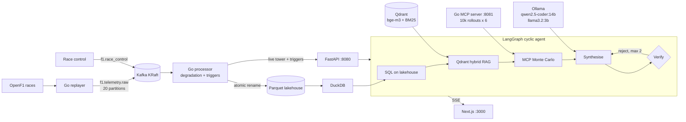

# PitWall AI

PitWall AI is a Formula 1 pit-wall strategy engine. It runs on real OpenF1 telemetry
from three Grands Prix (2023 Singapore, 2024 British, 2024 Sao Paulo), streamed through
Kafka into Go engines. These engines track fuel-corrected tyre degradation per car,
raise undercut, tyre-cliff, safety-car and wet-crossover triggers, and commit a
Parquet lakehouse that DuckDB queries while it is being written. When a trigger or a
race-control message arrives, a cyclic LangGraph agent does four things:
- reads the car's history from the lakehouse with SQL;
- retrieves the FIA Sporting Regulations in force on that race day from a Qdrant
  hybrid index;
- asks a Go Monte Carlo simulator over MCP to race 10,000 futures for each of six
  strategies;
- has the resulting call checked by a deterministic rule checker and a verifier
  model, and revises it if either rejects it.

The FastAPI control plane streams every step over SSE to a Next.js dashboard.

Everything runs on local models through Ollama, with zero paid API keys:
- **qwen2.5-coder:14b** writes the lakehouse SQL and synthesises the strategy.
- **llama3.2:3b** runs the fast verification pass and takes over when the primary
  model fails.
- **bge-m3** embeds the regulations for the Qdrant hybrid index.

Decisions are point-in-time: the agent sees only the laps, telemetry, race-control
notices and regulation edition that existed at the decision instant. The 2023 race is
judged under the 2023 rules, not later ones.

## Results on real models and telemetry streams

Measured on an Apple M5 Pro (15 cores, 24 GB). Source: `benchmarks/results.json`;
method and caveats in [docs/BENCHMARKS.md](docs/BENCHMARKS.md).

| Measurement | Result |
|---|---|
| Kafka -> Go engines, 200,000 real events, 20 partitions | **902,748 events/s** sustained (median of 5 trials, range 875k-958k); 685,392 events/s committed to Parquet, with offsets committed only after the rows are durable |
| Stream-to-trigger latency at 20,000 events/s | p50 2.0 ms, p99 4.0 ms |
| DuckDB on the Parquet lakehouse while Go writes it | 32,784 concurrent queries, **0 errors**, p50 1.06 ms |
| Go Monte Carlo, 10,000 rollouts x 6 strategies over MCP | **p50 7.0 ms** round trip |
| Qdrant Recall@3, hybrid RRF + rerank vs dense only (40 FIA queries) | **0.975 vs 0.900** (situational queries 0.950 vs 0.800) |
| FIA rule compliance (24 scenarios): cyclic agent / simulator only / single-pass LLM | **100%** / 100% / 67% |
| Agreement with ground truth: agent / simulator only / single pass | **96%** / 92% / 38% |
| Radio-override traps (urgent radio demanding an illegal or train-bound call) | agent 4/4 legal, single pass 2/4 |
| Cited FIA articles that exist in the edition in force | 100% for the agent (35) and the single pass (29) |
| Agent under sampling noise (temperature 0 / 0.3 / 0.7, 3 runs each) | 100% compliant in all 9 runs; 19 illegal first drafts, 7 fixed by the model's own revision in one cycle, 12 by the guardrail |
| Determinism at temperature 0 | identical calls in 24/24 scenarios across 3 runs, both arms |
| Failover under 10% injected primary-model faults (3 fault seeds) | **22/22** served by llama3.2:3b, 0 client errors; agent compliance 100% on every seed |
| Agent latency, end to end on local models | p50 11.3 s, p95 15.7 s (single pass 8.9 s, simulator alone 8 ms) |

## What is verified

- **Strategy calls on real models.** Each call is checked against the FIA
  regulation edition in force on the race date:
  - two dry compounds;
  - penalty holds served with no work on the car;
  - no stop while the pit entry is closed;
  - tyres that suit the track;
  - no green-flag rejoin into a DRS train.

  The 24 scenarios run end to end on qwen2.5-coder:14b, llama3.2:3b and bge-m3, with
  injected model faults. They cover 7 real decisions from the three races, 13 rule
  traps and 4 radio-override traps. The tests also prove two things about the agent:
  - the verifier rejects an illegal call and the cycle revises it (shown with a
    scripted model against the real simulator);
  - a primary-model failure is served by the fast model, with no error reaching the
    client.
- **Concurrency in Go, under the race detector:**
  - Each car's events stay in order on one Kafka partition.
  - Engines that process a real race share the live tower without a data race.
  - DuckDB readers never open a half-written Parquet file while several writers
    commit.
  - The Monte Carlo simulator is deterministic for a seed under concurrent calls,
    and its tyre, penalty, traffic and weather models move the decision the way
    they should.
- **Kafka, DuckDB and Qdrant integration, with no hindsight:**
  - At a decision instant the agent sees only completed laps, the field at that
    moment, messages already sent and the regulations then in force. Its SQL cannot
    read later laps, telemetry or sessions. Retrieval returns no later edition and no
    later notice.
  - Go's degradation slope equals DuckDB's `REGR_SLOPE` on the same laps.
  - The committed lakehouse holds each recorded event exactly once.
  - A race replayed through Kafka reaches the processor.
  - On SIGTERM the processor leaves its consumer group and flushes buffered batches.
- **The dashboard in a real browser.** Playwright in Chromium checks four things:
  - the live tower;
  - a cyclic run streamed over SSE, including its revision step;
  - strategy-chart tooltips and the table view;
  - race-control triggers for the selected car.

  One test runs a real 2023 Singapore decision through the browser on the live stack.
  After a reconnect, SSE resumes from `Last-Event-ID` with no gaps or duplicates.

Each suite and what it checks: [docs/TESTING.md](docs/TESTING.md).

## How it works



**Stream.** Telemetry is keyed by driver number, so each car's events stay in order on
one of 20 partitions. One Go engine per partition keeps a 5-lap fuel-corrected
degradation window per car. It publishes the live tower through lock-free snapshots
and commits Parquet batches by atomic rename, so DuckDB never sees a partial file.

**Agent.** When the agent runs, it first scopes its SQL and retrieval to the decision
instant. It then calls the simulator over MCP (JSON-RPC 2.0). The simulator prices pit
loss, penalty holds, tyre warm-up and cliffs, traffic, overtaking difficulty and rival
degradation. Next it synthesises a call with the primary model. Finally the rule
checker and the llama3.2:3b critic verify it, sending it back for at most two
revisions before a guardrail falls back to the simulator's best legal plan.

## Quickstart

```bash
make venv          # Go, Python, Qdrant, JDK 21 and Kafka 4.4 KRaft, all inside .venv/
make ollama-pull   # qwen2.5-coder:14b, llama3.2:3b, bge-m3
make run           # Kafka + Qdrant, Go MCP simulator :8081, Go processor :8090, FastAPI :8080
make web-dev       # dashboard on http://localhost:3000
make bench         # three benchmarks -> benchmarks/results.json
```

On a fresh clone, run `make lakehouse index` once after `make run` to build the
Parquet lakehouse and the Qdrant index from the committed data. Then ask for a
decision: the 2023 Singapore GP, lap 44, a VSC, with Hamilton on 23-lap-old hards.

```bash
curl -s localhost:8080/api/strategy -H 'content-type: application/json' \
  -d '{"scenario_id":"GP02","mode":"agent"}' | jq '{final: .final.recommended_action, cites: .final.fia_article_citations, compliant: .assessment.compliant}'
```

## Documentation

- [docs/ARCHITECTURE.md](docs/ARCHITECTURE.md): the stream, simulator, knowledge
  layer, agent graph, control plane and dashboard, and the point-in-time rules.
- [docs/BENCHMARKS.md](docs/BENCHMARKS.md): the three benchmarks, their method, raw
  numbers and caveats.
- [docs/TESTING.md](docs/TESTING.md): what every Go, Python, Jest and Playwright suite
  verifies.
- [docs/OPERATIONS.md](docs/OPERATIONS.md): setup, services, replays, configuration,
  Docker Compose and troubleshooting.
- [CHANGELOG.md](CHANGELOG.md): every real defect found during the build, and how it
  was found.

## Repository layout

```
cmd/            processor, replayer, mcp-sim, bench-stream (Go entry points)
internal/       stream engines, Kafka, Parquet sink, Monte Carlo, MCP server, metrics
python/pitwall/ olap (DuckDB), rag (Qdrant), agents (LangGraph), api (FastAPI), eval
web/            Next.js dashboard, Jest and Playwright suites
data/           OpenF1 races, FIA regulation corpus, 24 scenarios, lakehouse schema
scripts/        .venv bootstrap, services, data builders, bench and smoke scripts
benchmarks/     raw benchmark outputs and results.json
docker/         Dockerfiles for docker-compose.yml
```

## Limitations

- **Single machine.** One Kafka broker without replication. Producer, broker,
  engines and models share one laptop, so the throughput figures are for this setup,
  not a cluster.
- **Small evaluation sets.** 24 strategy scenarios and 40 retrieval queries. On
  retrieval, differences of one or two queries are within noise. The reranker default
  was chosen on the same 40 queries.
- **Synthetic ground truth.** 17 of the 24 scenarios are synthetic, with ground truth
  reasoned from the regulations. The simulator's tyre model is a calibrated
  approximation, not team data. GP03, GP11 and GP12 prompted simulator changes, so
  they are not held-out tests, and agreement is also reported without them. Six
  scenarios are knife-edge under input noise
  ([docs/BENCHMARKS.md](docs/BENCHMARKS.md)).
- **Most of the value is the simulator.** On its own it is as compliant as the agent
  and agrees with the ground truth in 22 of 24 scenarios, in milliseconds. The
  language-model layers add one scenario of agreement, cited regulations and an
  explanation, at about 11 s per decision. At production settings (greedy decoding)
  the revision cycle rarely fires; the guardrail does most of the correcting. Under
  sampling noise the model's own revision fixed 7 of 19 illegal drafts.
- **GP03 is still wrong, consistently.** The simulator does not model rivals pitting
  under a VSC, so at Singapore 2023 it prefers a stop that Sainz, who won, did not
  make. The prediction is stable under input noise.
- **Inputs not in OpenF1.** Track wetness and the 2024 Sao Paulo pit loss (one green
  stop measured) are estimates.
- **One processor per lakehouse.** Kafka offsets are committed only after their
  Parquet rows are on disk, and per-table high-water marks stop re-delivered records
  from being written twice after a crash, restart or rebalance. The marks assume one
  processor per lakehouse directory, as the stack runs it
  ([docs/ARCHITECTURE.md](docs/ARCHITECTURE.md)).
- **Docker Compose is smoke-tested, not benchmarked.** CI builds the images and
  checks the containerised stack's health, readiness and status on every push. Ollama,
  the Qdrant index job and the dashboard image are not part of that check. Every
  number here comes from the native `.venv/` stack.
- **Unchecked radio text.** The engineer radio text is model-written and not checked
  by the guardrail.
