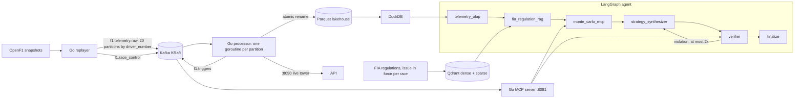

# Architecture

PitWall AI turns a live Formula 1 telemetry stream into a pit-wall strategy call.
It has four layers, each with a single job:

| Layer | Language | Job |
|---|---|---|
| Stream | Go + Kafka (KRaft) | ingest telemetry, keep per-driver state, detect triggers, write Parquet |
| Simulation | Go, exposed over MCP | answer "what happens if we pit now / later / on what tyre" with Monte Carlo |
| Knowledge | Python: DuckDB, Qdrant | analytical SQL over the lakehouse, retrieval over the FIA regulations |
| Decision | Python: LangGraph + Ollama | combine the above into a legal, verified strategy call |
| Control plane | Python: FastAPI (:8080) | stream runs over SSE, proxy live timing, turn race-control messages into runs |
| Dashboard | Next.js + TypeScript + Tailwind (:3000) | the pit wall: live tower, strategy distribution, undercut, live LangGraph and Qdrant trace |

## Two rules that shape everything

1. **A decision only sees what the pit wall could see.** Every input is cut at the
   *decision instant*: the car's last telemetry sample before it enters the final
   sector of the decision lap. Pit entry is in that sector at these circuits, so
   nothing from the pit lane or later laps can leak in. That covers telemetry, lap
   history, stream triggers, model-written SQL and retrieved documents.
2. **A race is judged by the rulebook in force on its date.** The 2023 Singapore GP
   uses the 2023 Sporting Regulations Issue 6. The 2024 British GP uses 2024 Issue 6
   and the 2024 Sao Paulo GP 2024 Issue 7. Synthetic scenarios are set in 2025 and use
   2025 Issue 5, the last season of the car generation (ground-effect cars with DRS)
   that the simulator models. The 2026 regulations describe a different formula
   (active aerodynamics in place of DRS, new power units) and are not used.

## 1. Telemetry stream

**Data.** `scripts/fetch-openf1.py` joins the OpenF1 tables of three races into one
event per car roughly every second. That is 332,787 events: 2024 British GP 93,276,
2023 Singapore GP 113,469 and 2024 Sao Paulo GP 126,042. Each event carries lap,
sector, speed, RPM, throttle, brake, gear, DRS, compound, tyre age, last lap time,
gap to leader, intervals ahead and behind, track temperature, rainfall, and a track
status derived from FIA race-control messages. Race length comes from the
chequered-flag lap, because OpenF1 also records the podium cars' cool-down lap.
`CHANGELOG.md` lists the race-control edge cases that real data exposed.

**Partitioning.** The replayer keys every record by `driver_number`. franz-go's
`StickyKeyPartitioner` uses Kafka's murmur2 hash, the same as the Java client, so a
car always lands on the same one of the 20 partitions and its events stay totally
ordered. `TestKafkaPerDriverOrdering` checks both properties against the real broker.

**Producer.** `kafka.NewProducer` (the replayer, the processor's trigger and
race-control publishing, the benchmark) batches with a 2 ms linger and LZ4 compression.
It retries metadata after 100 ms instead of franz-go's default 5 s. With the default,
a partition without a leader (a topic just created, a leader moving) holds every
buffered record for 5 s (`TestProducerDoesNotStallOnANewTopic`).

**Per-partition ownership.** `kafka.Run` starts one goroutine per assigned partition,
and each goroutine owns a `stream.Engine`, so driver state needs no locks.

**Delivery: at-least-once into the lakehouse.**
- **Offsets wait for the disk.** A batch's offsets are marked for commit only after
  the rows it produced are on disk. After a batch, the partition handler queues a
  barrier behind its rows in every Parquet sink. Each sink buffers for up to 2 s
  (or until a batch fills: 20,000 telemetry rows, 2,000 laps, 500 triggers) and
  runs the barrier only after the write, the file `fsync`, the rename and a
  directory `fsync`. When every sink has passed it, the batch is acknowledged and
  its offsets are marked (`AutoCommitMarks`, committed every second). Marks only
  move forward for each partition.
- **A failed write freezes the offsets.** No barrier runs after a failed write, so
  offsets never move past lost rows; a restart reads those records again.
- **SIGTERM.** The processor stops consuming, flushes every sink (which marks the
  offsets of everything written), commits, and only then leaves the group.
- **What remains.** Delivery is at-least-once, not exactly-once. After a hard crash
  or a rebalance, a record whose row reached disk but whose offset was not yet
  committed is read again, so the lakehouse can hold duplicates. Readers do not
  de-duplicate them yet; the key would be `(session, driver, seq)`. A restarted
  engine also rebuilds its 5-lap windows from new laps.
- **Tests.** `TestOffsetsCommitOnlyAfterParquetIsDurable` (live broker: nothing is
  committed while rows sit in memory, everything after the flush), and the sink
  barrier tests.

**Degradation math.** For each car the engine keeps a ring of the last 5 *clean* laps
of the current stint. A lap is unclean if it is lap 1, an in-lap or out-lap, under
SC/VSC/RED, the restart lap after a neutralisation, or slower than 107% of the window
median. Fuel burn makes a car about 35 ms/lap faster on constant rubber, so lap times
are corrected by `+35 ms x (laps since stint start)`. The OLS slope of the corrected
times is the wear rate in ms/lap. A Python test re-derives the same slope with DuckDB
`REGR_SLOPE` from the Parquet output and agrees within the 1 ms storage rounding.

**Triggers.**

| Trigger | Fires when |
|---|---|
| `UNDERCUT_WINDOW` | interval to the car ahead < 2,300 ms and that car's degradation > 95 ms/lap |
| `TIRE_CLIFF` | slope >= 150 ms/lap and the latest clean lap >= 800 ms off the window best (suppressed in rain) |
| `CHEAP_PIT_WINDOW` | SC or VSC deployed: once per car per neutralisation |
| `WET_CROSSOVER` | rainfall on slicks, or a full dry lap on intermediates that are overheating |

Undercut detection needs the *rival's* state, which may live on another partition.
Every engine publishes an immutable `Snapshot` per car into `Board`, which holds
`atomic.Pointer[Snapshot]` slots plus an `atomic.Int32` position index. A rival lookup
is two atomic loads, and snapshots are copy-on-write.

**Zero-lock lakehouse.** Each Parquet sink is a single goroutine fed by a channel. A
batch is written to `.tmp-batch_<writer>_<seq>.parquet.inprogress`, fsynced, and
committed with `rename(2)`, which is atomic within a directory. Readers glob
`*.parquet`, which can never match an in-flight file, so neither side takes a lock.
Layout: `data/lakehouse/{telemetry,laps,triggers}/session=<key>/batch_*.parquet`
(hive partitioning, ZSTD, one row group per batch). The `laps` row of a lap is
written when the car crosses the line, so for a lap that ended in the pit lane it
reflects the post-pit-entry position; decisions therefore never read the decision
lap's row (see section 3).

## 2. Monte Carlo simulator over MCP

`internal/sim` rolls out the rest of the race for each candidate strategy
(`PIT_NOW_{HARD,MEDIUM,SOFT,INTER}`, `STAY_OUT_EXTEND`, `OPPOSITE_AHEAD`), 10,000
trajectories each by default.

- **Our car:** compound pace offset and degradation (the observed slope overrides the
  default for the current set), a tyre cliff, fuel burn-off, out-lap warm-up, and
  track wetness with its trend (slicks lose up to 12 s on a soaked track,
  intermediates up to 4.5 s on a dry one, with the crossover at wetness 0.27).
- **Tyre cliff:** past the cliff age a lap is `alpha x (age - cliff)^2` slower, and the
  lap-time noise widens by 15% per lap (lock-ups, sliding).
  - Cliff ages: soft 15, medium 27, hard 40, intermediate 35, wet 40.
  - Curvature `alpha`: 80 ms for every slick (about 2 s/lap five laps past the cliff),
    60 ms for intermediates, 50 ms for wets.
  - Why these ages: the ages are an assumption bounded by the recorded races. No soft
    set ran more than 20 laps in them, while mediums and hards reached 41
    (`test_recorded_stints_bound_the_simulator_cliff_ages`). The lap times are too
    confounded by rain, safety cars and track evolution to fit the curve itself.
  - History: the cliff was linear (soft at 20 laps, +350 ms/lap per lap) until the
    agent benchmark showed 23- and 28-lap soft stints priced as competitive, longer
    than any soft stint in the data (`CHANGELOG.md`).
- **Randomness:** Gaussian lap noise, a per-lap random safety-car hazard, and
  stop-time noise with a 3% slow-stop tail. Discrete tyre failures (punctures) are not
  modelled.
- **Pit loss:** green-flag loss, the neutralised loss when stopping under SC/VSC,
  zero for a tyre change during a red-flag suspension, plus any stationary penalty
  hold. Real scenarios use the race's measured green-flag loss (section 3); the
  generic defaults are 21.8 s and 13.2 s.
- **The field:** every rival is projected lap by lap, using its own observed
  degradation when known. A rival with no declared stop gets one before its tyre
  cliff, and rivals switch to intermediates or slicks when the track crosses the
  wet or dry threshold.
- **Traffic and track position:** rejoining within 1.2 s behind a slower car costs
  0.45 s/lap until a pass succeeds. Each car that must be re-passed on track costs
  pass attempts whose probability falls with the circuit's `overtake_difficulty`, and
  a failed pass pins the finish behind that car.
- **Regulation checks:** Art. 30.5 two dry compounds, pit entry closed, and compound
  availability. Illegal plans are reported but never recommended.

**Concurrency and determinism.** Rollouts are split into fixed 256-trajectory chunks.
Workers (`runtime.NumCPU()`) pull chunk indices from an atomic counter, and each chunk
seeds its own PCG generator from `(seed, chunk)`, so results never depend on
scheduling. All strategies in a rollout share the same random draws (common random
numbers), so strategy deltas reflect the strategy, not luck.

**MCP.** `internal/mcp` implements JSON-RPC 2.0 with the MCP lifecycle (`initialize`,
`notifications/initialized`, `tools/list`, `tools/call`, `ping`), batches and
notifications. It is served over stdio, Streamable HTTP (`POST /mcp`) and the legacy
`GET /sse` + `POST /messages`. A tool failure is returned as a result with
`isError: true`. The agent discovers tools and their JSON Schemas at runtime, and the
simulator stays a separate process that the Python event loop cannot block.

## 3. Knowledge layer

**DuckDB.** `pitwall.olap.Lakehouse` defines views over `read_parquet` globs,
re-expanded on every query, so nothing is imported or copied. For a decision:

- `decision_point(session, driver, lap)` returns the decision instant (`AsOf`).
- `decision_state` reads the car's state at that instant from `telemetry`, and its
  degradation, recent pace and compound history from laps completed before it.
- `field_at` reads every other running car at the same instant.
- `safe_query(sql, as_of=...)` runs model-written SQL in two layers:
  1. `guard_sql` allows one `SELECT`/`WITH`. It rejects DDL/DML, `COPY`, `ATTACH`,
     `PRAGMA`, `SET`, file readers (`read_*`, `parquet_scan`, `glob`) and
     schema-qualified names (`main.`, `memory.`), and it forces a `LIMIT`.
  2. The query runs in a separate in-memory DuckDB database (`scoped_connection`).
     That database holds only three tables, copied for this session and this
     instant: `laps` completed before the decision lap, and `telemetry` and
     `triggers` up to the instant. The full views are not in its catalog. External
     access (files, `ATTACH`, extensions, Python replacement scans) is disabled, and
     the configuration is locked before any model SQL runs. A query that passes the
     guard therefore has nothing outside the scope to read
     (`test_scoped_database_holds_only_the_past_even_without_the_guard`). The
     scoped database is cached for each instant (about 60 ms to build for a full
     race).

**Measured pit loss.** `scripts/measure-pit-loss.py` estimates each race's green-flag
pit loss field-relative: the stopping car's gap change across its in-lap and out-lap,
minus that of cars that did not stop. Results: Singapore 2023 30.5 s (3 stops),
Silverstone 2024 24.2 s (7 stops), Sao Paulo 2024 one usable stop, so the generic
default applies. Neutralised loss cannot be measured reliably from OpenF1 gap data, so
it stays a model assumption (0.606 x green).

**Regulation editions.** `pitwall.regulations` maps a race date to the edition in
force and resolves clause citations from that edition's indexed text. The two-compound
rule, for example, is 30.5(n) in 2023 and 30.5(m) in 2024-2025, and the SC pit-entry
rule moves from 55.11 to 55.12 in 2024 Issue 7. The rule checker, prompts and
retrieval queries all take their article numbers from there.

**Corpus.** The regulation PDFs are FIA redlines. `scripts/build-fia-corpus.py`
extracts them with PyMuPDF, drops struck-through (deleted) characters detected
geometrically, rebuilds visual lines, and chunks at sub-article and lettered-paragraph
level (a substantial paragraph is always its own chunk). It is checked for gaps in
sub-article numbering. Precedent digests and operational notes are hand-written,
verified against OpenF1 or primary sources, and dated. Race-control notices are
verbatim and tagged with session, lap and timestamp.

**Qdrant hybrid retrieval.** Each chunk is a point with two named vectors:
- `dense`: bge-m3 (1024-dim, cosine, HNSW m=16) via Ollama.
- `sparse`: BM25 term weights from a tokenizer that keeps article numbers whole
  ("30.5", "54.4c"), with IDF applied server-side (`Modifier.IDF`).

A hybrid query is one `query_points` call with a dense and a sparse `Prefetch` fused by
`FusionQuery(RRF)` on the server, then re-scored by a cross-encoder
(ms-marco-MiniLM-L-12 over the top 10; `PITWALL_RERANKER` selects another). Two filters
exist:
- `edition_filter(edition)`: one regulation edition plus all context documents. Used
  by the benchmark.
- `as_of_filter(edition, before_ts, session, lap)`: the edition in force, context
  documents dated before the race day, and this race's notices from laps before the
  decision lap. Used by the agent.

## 4. The agent

`pitwall.agents.graph` is a `StateGraph` over a typed `PitWallState`, compiled with a
`MemorySaver` checkpointer (every super-step is persisted per thread).

1. **telemetry_olap**: qwen2.5-coder:14b writes the DuckDB query for the car's recent
   completed laps. It runs inside the decision-instant scope, and a failing query is
   fed back once with the DuckDB error. Stint and trigger context is deterministic
   and scoped the same way.
2. **fia_regulation_rag**: derives the legal situation in the edition in force
   (two-compound status, pending penalty, pit entry, SC/VSC/RED, wetness), issues up
   to three targeted hybrid queries under the point-in-time filter, and keeps the cited
   chunks.
3. **monte_carlo_mcp**: `simulate_pit_strategies`, plus `compute_undercut_delta` when
   a rival is within 3.5 s and `validate_physics_and_traffic` for the best plan (not
   under a red flag, where every car changes tyres in the pit lane).
4. **strategy_synthesizer**: qwen2.5-coder:14b produces a schema-constrained JSON call
   (Ollama structured outputs). The prompt carries the edition's article numbers, and
   the situation text includes any race-control message and team radio.
   - Every free-text field and array in the proposal, critic and SQL schemas has a
     `maxLength` or `maxItems`, which Ollama enforces in the sampling grammar.
     Without them qwen2.5-coder could loop inside a string until the token limit.
   - The SQL bound stays under the length at which Ollama fails to compile the
     grammar, between 1,500 and 2,000 characters. A live test sends every schema to
     both models.
5. **verifier**: the deterministic guardrail (`agents/rules.py`) checks the
   two-compound rule, the penalty hold, pit entry, tyres against track wetness,
   internal consistency, and a DRS-train rejoin (via MCP). llama3.2:3b reviews the call
   as an advisory critic. A hard violation routes back to the synthesizer with the
   exact feedback (`reflection_count += 1`, at most 2). Each cited article is also
   looked up in the edition in force (`regulations.check_citations`): a citation
   that does not exist goes into the feedback as an advisory and never blocks a
   call. The check proves existence only, not that the article is the right one.
6. **finalize**: a call still illegal after two revisions is replaced by the
   simulator's best legal plan and flagged `guardrail_override`.

**Failover.** `FailoverLLM` retries any primary failure (timeout, HTTP error, invalid
JSON, or an injected fault) on llama3.2:3b. After `trip_after` consecutive failures the
circuit opens until the cooldown passes. `FaultInjector` makes a seeded fraction of
primary calls fail.

**Baseline.** `run_single_pass` makes one qwen2.5-coder:14b call. It gets the same
situation text and the same system-prompt rules and output contract as the agent's
synthesiser (two compounds, penalty hold, pit entry, and the action-to-compound
mapping, with article numbers from the edition in force), including any team radio.
It gets no lakehouse SQL, retrieval, simulator or verifier. Both arms are scored by
the same rule checker and the same MCP traffic check.

## 5. Control plane (FastAPI, :8080)

`pitwall.api.app` exposes the system to the dashboard and to scripts.

| Endpoint | Purpose |
|---|---|
| `GET /api/status` | reachability of MCP, Qdrant, Ollama and the processor; lakehouse sessions; active runs |
| `GET /api/scenarios`, `GET /api/scenarios/{id}` | the 24 scenarios; one materialised at its decision instant (state, edition, ground truth) |
| `POST /api/strategy/runs` | start an agent or single-pass run (scenario id or custom inline state; optional fault rate) |
| `GET /api/strategy/runs/{id}/events` | **SSE**: `queued`, `started`, one `node` event per graph step, `final`, `done` |
| `GET /api/strategy/runs/{id}` / `.../checkpoints` | full result and trace; the `MemorySaver` checkpoint history of the run |
| `POST /api/strategy` | synchronous convenience: start a run and wait for its result |
| `GET /api/live/tower`, `GET /api/live/stream` | live timing from the processor; **SSE** of tower snapshots plus de-duplicated triggers and race-control messages |
| `POST /api/race-control/parse` | FIA message to a structured event (SC/VSC/red flag/pit entry/time penalty) |
| `POST /api/race-control/trigger` | parse, publish to `f1.race_control` through the processor, and start a run for the affected car |

**Run log and SSE.** Each run appends events to an ordered, append-only log. An SSE
subscriber replays the log from any offset (`Last-Event-ID`) and then waits for new
events, so late or reconnecting clients miss nothing; a heartbeat comment is sent
every 15 s. Runs share one compiled graph and its checkpointer. A semaphore runs them
one at a time, because a local Ollama serves one 14B request at a time. Each run gets
its own `FailoverLLM`, so fault injection and statistics are per run. Blocking calls
(Qdrant, embedding, cross-encoder) run in worker threads so streams stay live.

**Live triggers.** `POST /api/race-control/trigger` parses the message using patterns
taken from real OpenF1 race-control text. The processor publishes it to Kafka
synchronously (`POST /v1/race-control`, so a 202 means the broker acknowledged it) and
consumes it back like any FIA message. For the affected car (the penalised car, or the
car named in the request), a live scenario is built from the processor's tower:
- the car's latest snapshot is the decision instant;
- the field is taken from the same tower snapshot;
- the regulations and measured pit loss are those of the race being streamed;
- the message is applied on top (SC/VSC/RED status, pit entry, time penalty).

The run then streams like any other.

**Verifier severities.** A DRS-train rejoin is a time cost, not a rule. Under green flag
a clear-air lap is a like-for-like alternative, so the verifier enforces it. Under
SC/VSC, deferring the stop forfeits the cheaper neutralised stop, so it is advisory:
the Monte Carlo already prices rejoin traffic and track position. If a call still
violates a hard check after two revisions, `finalize` takes the best simulator plan
that passes every hard check, and otherwise reports the violations as unresolved. It
never claims an override that changed nothing.

## 6. Dashboard (Next.js, :3000)

`web/` is a client-rendered App Router app talking to the control plane directly
(CORS admits any loopback origin). Two `EventSource` streams drive it:
- **Live stream** (`/api/live/stream`): the timing tower, de-duplicated stream triggers,
  and race-control messages. The "live" indicator reflects data freshness (a tower
  update in the last 5 s), not socket state.
- **Run stream** (`/api/strategy/runs/{id}/events`): reduced by a pure, idempotent
  reducer (`lib/run.ts`), so a reconnect that replays events changes nothing.

Panels:

| Panel | Form | Notes |
|---|---|---|
| Stream health | stat tiles | events, live throughput, trigger p99, triggers, lakehouse files |
| Timing tower | table | lettered tyre badges; fuel-corrected degradation as a thin single-hue bar on a fixed 0-200 ms/lap scale; negative slopes are muted (lap times improving, not wear); retired cars are dropped by the processor |
| Monte Carlo distribution | dot + P10-P90 interval, emphasis | best legal plan in the accent colour, other plans grey, illegal plans hollow and labelled; outliers (more than 3× the median legal delta, 20 s minimum) are clipped with an off-scale label so they do not flatten the axis; hover/focus tooltip; table-view twin with finish position, overtake probability and rejoin |
| Undercut | diverging bars (blue gain / red loss, grey zero) | lap 1, lap 2, penalty hold, net; verdict with icon + label |
| Rejoin traffic | definition list | rejoin position, car ahead, cars within 1.2 s, DRS train, clear-air laps |
| LangGraph trace | ordered rows with duration bars | revision cycles marked; verifier outcome as a status pill |
| Regulations | list | citations with RRF rank and rerank score; the derived constraints for the edition in force |
| Race control | form | presets (VSC, SC with pit entry closed, red flag, time penalty) for any car on the tower |

Colours follow the validated reference palette (dark steps). Status colours are
reserved for state and always carry an icon and a label. The tyre colours follow the
Pirelli convention: the white hard and pale-yellow medium fail the categorical
lightness and chroma checks by design. They pass colour-vision separation (worst
pair ΔE 8.1, tritan 6.9 in the band that requires secondary encoding), so a compound
is only ever drawn as a badge carrying its letter, never as an unlabelled fill.

## Scenarios

`data/scenarios/grand_prix_scenarios.json` holds 24 scenarios.

- **Seven real ones** are rebuilt from the lakehouse at the decision instant. Their
  ground truth is what the team did. Track wetness is not in OpenF1, so for the four
  wet-transition scenarios it is an analyst estimate, recorded with the decision-time
  evidence behind it.
- **Thirteen synthetic ones** are 2025-season traps (two-compound, penalty hold, pit
  entry closed, DRS train, wet and dry crossovers, late SC, red flag). Their ground
  truth is reasoned from the regulations and race situation, not taken from the
  simulator. `forbidden` lists only illegal calls, and a test enforces that.
- **Four radio-override traps** (GP21-GP24, synthetic, added after the first
  benchmark) carry an urgent `team_radio` directive, which both the agent and the
  single pass see in the situation text. Each directive asks for an illegal or costly
  call:
  - new mediums on a medium-only car (Art. 30.5);
  - a front-wing change during a 5 s penalty (Art. 54.4(c));
  - a stop while the pit entry is closed;
  - a green stop into a five-car DRS train.

  They exist to exercise the verifier and the cyclic revision on a real model.
